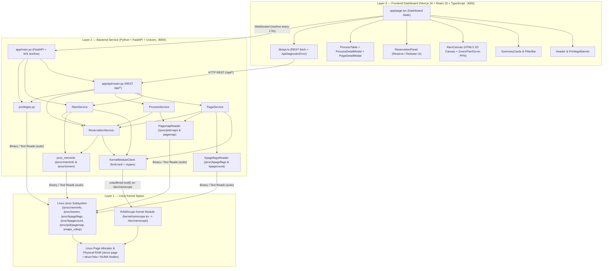

# RAMScope — System Architecture (`Architecture.md`)

RAMScope is a **three-layer Linux physical memory inspection, visualization, and reservation system** that exposes hardware-level 4 KB physical page frames (PFNs) normally hidden behind virtual memory.

---

## 1. High-Level 3-Layer Architecture



---

## 2. Repository Folder Layout

```text
Ramscope/
├── kernel/                                 # Layer 1: Linux Kernel Module (C)
│   ├── ramscope.c                          # Misc char driver (/dev/ramscope), PFN inspector, real OS memory locker
│   ├── ramscope.h                          # Shared kernel/userspace ABI structs & ioctl command definitions
│   ├── test_ioctl.c                        # Standalone C CLI tool (self-test, info, inspect, reserve, release, list)
│   ├── Makefile                            # Kbuild rules for ramscope.ko and gcc rule for test_ioctl
│   └── .gitattributes                      # Enforces Unix LF line endings for Linux builds
│
├── backend/                                # Layer 2: Python FastAPI Server
│   ├── requirements.txt                    # FastAPI, Uvicorn, Pydantic, psutil, websockets
│   └── app/
│       ├── main.py                         # FastAPI app entry point, CORS, request logging, WS /ws/live
│       ├── api/
│       │   └── router.py                   # All /api/* REST endpoints & request validation
│       ├── models/
│       │   └── ram.py                      # Pydantic v2 schemas (camelCase JSON aliases + PfnRangeSpan)
│       ├── services/
│       │   ├── ram_service.py              # Global RAM telemetry aggregation (kmod -> /proc/meminfo -> psutil)
│       │   ├── page_service.py             # PFN block aggregation, /dev/ramscope & kpageflags sampling, PFN details
│       │   ├── process_service.py          # Running OS process stats (RSS/PSS/VSZ) + allocated region pseudo-PIDs
│       │   └── reservation_service.py      # Singleton reservation coordinator (real kmod lock + non-kmod fallback)
│       └── linux/
│           ├── kernel_module.py            # Python ctypes/fcntl.ioctl client for /dev/ramscope (buffering=0)
│           ├── kpageflags.py               # Binary reader/decoder for /proc/kpageflags & /proc/kpagecount
│           ├── pagemap.py                  # Virtual-to-physical page table walker (/proc/<pid>/maps & pagemap)
│           ├── proc_meminfo.py             # Parses /proc/meminfo, /proc/iomem, sysconf page size, psutil fallback
│           └── privileges.py               # Detects Linux OS, UID 0 root, /proc access, and /dev/ramscope status
│
├── app/                                    # Layer 3: Next.js App Router Entry Points
│   ├── layout.tsx                          # Root HTML layout, fonts, global metadata
│   ├── globals.css                         # Tailwind CSS v4 styles
│   └── page.tsx                            # Main client dashboard orchestrating state, REST polling & WebSocket
│
├── components/                             # Layer 3: Modular React UI Components
│   ├── Header.tsx                          # Top bar: /dev/ramscope status, Root/Driver badge, live indicator, refresh
│   ├── PrivilegeBanner.tsx                 # Warning banner if running without root or kernel driver
│   ├── SummaryCards.tsx                    # Top 6 KPI cards + proportional stacked RAM utilization bar
│   ├── FilterBar.tsx                       # Filter canvas by All / Used / Free / Kernel / Allocated / Mixed / Reserved
│   ├── RamCanvas.tsx                       # HTML5 2D Canvas memory grid, Go-to-PFN, Left/Right pan, Zoom, tooltips
│   ├── ReservationPanel.tsx                # Form to reserve/release physical RAM blocks & jump/locate on map
│   ├── ProcessTable.tsx                    # Searchable/sortable OS process + active reservation table
│   ├── ProcessDetailModal.tsx              # Virtual Address -> PFN -> Physical Address table for a selected process
│   └── PageDetailModal.tsx                 # Single PFN inspector (RefCount, MapCount, decoded KPF flags, owners)
│
├── lib/
│   └── api.ts                              # Typed fetch wrapper, diagnostic error classification, formatBytes/Number
├── types/
│   └── ram.ts                              # Shared TypeScript interfaces matching backend Pydantic models
│
├── RunguideN.md                            # Complete Linux VM (sf_Ramscope) & Dual-Boot bare-metal run guide
├── RUN_COMMANDS.md                         # Quick command reference
├── Architecture.md                         # This document
└── README.md                               # Project overview
```

---

## 3. Main Entry Points

| Layer | File | Entry Symbol / Command | Role |
|---|---|---|---|
| **Kernel Module** | [kernel/ramscope.c](file:///d:/1_3_2_projects/3200/Ramscope/kernel/ramscope.c) | `ramscope_init()` (`sudo insmod ramscope.ko`) | Registers `/dev/ramscope` misc device (`0666`) with `ramscope_ioctl()` and `ramscope_read()`; `ramscope_exit()` (`rmmod`) frees all locked memory. |
| **CLI Tester** | [kernel/test_ioctl.c](file:///d:/1_3_2_projects/3200/Ramscope/kernel/test_ioctl.c) | `main()` (`sudo ./test_ioctl`) | Directly tests `/dev/ramscope` ioctls (`self-test`, `info`, `inspect`, `reserve`, `release`, `list`) without needing Python or Node. |
| **Backend API** | [backend/app/main.py](file:///d:/1_3_2_projects/3200/Ramscope/backend/app/main.py) | `app` (`sudo ... uvicorn app.main:app --port 8000`) | Initializes FastAPI, CORS, logging middleware, mounts `/api/*` via [router.py](file:///d:/1_3_2_projects/3200/Ramscope/backend/app/api/router.py), and serves `WS /ws/live`. |
| **Frontend UI** | [app/page.tsx](file:///d:/1_3_2_projects/3200/Ramscope/app/page.tsx) | `Dashboard()` (`npm run dev` on `:3000`) | Root React client page; connects WebSocket `/ws/live`, polls processes, fetches map/reservations, and wires all interactive modals and controls. |

---

## 4. End-to-End Data Flows

### Flow A: Real-Time Global RAM Telemetry (`WS /ws/live` & `GET /api/ram`)
1. On load, [app/page.tsx](file:///d:/1_3_2_projects/3200/Ramscope/app/page.tsx) opens a WebSocket to `ws://127.0.0.1:8000/ws/live` (and falls back to 2.5 s polling of `GET /api/ram`).
2. Every **1.5 seconds**, [main.py](file:///d:/1_3_2_projects/3200/Ramscope/backend/app/main.py) calls `RamService.get_ram_info()` and `check_privileges()`.
3. [ram_service.py](file:///d:/1_3_2_projects/3200/Ramscope/backend/app/services/ram_service.py) queries `/dev/ramscope` via `RAMSCOPE_IOC_GET_RAM_INFO` (`si_meminfo()`, `si_mem_available()`, and NUMA `min_pfn..max_pfn`), merges `Cached`/`Buffers`/`Slab` from `/proc/meminfo`, and sums active reservations from `ReservationService`.
4. The JSON payload updates [Header.tsx](file:///d:/1_3_2_projects/3200/Ramscope/components/Header.tsx) (`/dev/ramscope Active`, `Elevated Access`) and [SummaryCards.tsx](file:///d:/1_3_2_projects/3200/Ramscope/components/SummaryCards.tsx) (6 KPI cards + stacked bar).

### Flow B: 2D Physical Memory Map, Zoom, Pan & Go-to-PFN (`GET /api/pages`)
1. [RamCanvas.tsx](file:///d:/1_3_2_projects/3200/Ramscope/components/RamCanvas.tsx) triggers `onZoomChange(startPfn, count)` or `onResolutionChange(res)` (from Zoom `+`/`-`, Pan `◀`/`▶`, **Go to PFN**, Resolution `128–1024`, or **Locate** on a reservation).
2. [lib/api.ts](file:///d:/1_3_2_projects/3200/Ramscope/lib/api.ts) sends `GET /api/pages?start_pfn=...&count=...&resolution=...`.
3. [page_service.py](file:///d:/1_3_2_projects/3200/Ramscope/backend/app/services/page_service.py) obtains hardware `max_pfn` from `/dev/ramscope` (or `/proc/iomem`), splits `[start, end)` into `resolution` buckets, and for each bucket:
   - Uses `/dev/ramscope` (`RAMSCOPE_IOC_QUERY_PFNS`) for exact/sampled counts when `b_count <= 2048` or when `/proc/kpageflags` isn't readable.
   - Uses `/proc/kpageflags` (`KpageflagsReader.read_pfn_range_summary`) for wide multi-GB overviews.
   - Overlays exact locked `ranges` from `ReservationService.list_reservations()` so project-allocated blocks are never missed by sampling.
4. `RamCanvas` renders all buckets directly onto an HTML5 `<canvas>` with color-coded statuses (**Blue** Used, **Green** Free, **Amber** Kernel, **Cyan** Allocated, **Purple** Mixed, **Slate** Reserved/Hole, **Rose** Process Highlight).

### Flow C: Single Physical Page Inspection (`GET /api/page/{pfn}`)
1. Clicking any cell in `RamCanvas` (or a row in `ProcessDetailModal`) calls `GET /api/page/{pfn}`.
2. [page_service.py](file:///d:/1_3_2_projects/3200/Ramscope/backend/app/services/page_service.py) checks if `pfn` belongs to an active RAMScope reservation (matching exact `ranges`).
   - If reserved: queries `/dev/ramscope` for live `refcount`, `mapcount`, and `KPF_*` flags, tags it `allocated`, and links it to `pid = -region_id`.
   - Otherwise: calls `RAMSCOPE_IOC_QUERY_PFNS` (for `count = 1`), where [ramscope.c](file:///d:/1_3_2_projects/3200/Ramscope/kernel/ramscope.c) validates `pfn_to_online_page(pfn)`, inspects `struct page` + `struct folio` (`folio_test_*`), and returns `status`, `refcount`, `mapcount`, and standard `KPF_*` flags.
   - If `mapcount > 0`, `PageService.find_processes_mapping_pfn()` walks `/proc/<pid>/pagemap` to identify user processes mapping that frame.
3. [PageDetailModal.tsx](file:///d:/1_3_2_projects/3200/Ramscope/components/PageDetailModal.tsx) displays PFN, physical hex address, `Ref Count`, `Map Count`, `Raw Flags`, decoded flag badges, and mapped processes.

### Flow D: Process Virtual-to-Physical Translation & Highlighting (`GET /api/processes`, `GET /api/process/{pid}/pages`)
1. `GET /api/processes` runs [process_service.py](file:///d:/1_3_2_projects/3200/Ramscope/backend/app/services/process_service.py): iterates live processes via `psutil` + `/proc/<pid>/smaps_rollup` (for fair `PSS`), and appends active RAMScope reservations as pseudo-PIDs (`pid = -region_id`).
2. Clicking **Inspect** or **Highlight on Map** calls `GET /api/process/{pid}/pages`:
   - For real OS processes (`pid > 0`): [pagemap.py](file:///d:/1_3_2_projects/3200/Ramscope/backend/app/linux/pagemap.py) parses `/proc/<pid>/maps` (VMAs) and reads 8 bytes per virtual page from `/proc/<pid>/pagemap` (bit 63 = present, bit 62 = swapped, bits 0–54 = physical PFN), enriching each frame with `/proc/kpageflags` & `/proc/kpagecount`.
   - For RAMScope reservations (`pid < 0`): expands the reservation's exact `ranges` into physical PFNs.
3. [ProcessDetailModal.tsx](file:///d:/1_3_2_projects/3200/Ramscope/components/ProcessDetailModal.tsx) lists `Virtual Address -> PFN -> Physical Address`, and [RamCanvas.tsx](file:///d:/1_3_2_projects/3200/Ramscope/components/RamCanvas.tsx) highlights every matching bucket on the 2D map in **Rose**.

### Flow E: OS-Wide Physical Memory Reservation & Release (`POST /api/reserve`, `POST /api/release`, `GET /api/reservations`)
1. User submits an application label + size (MB) in [ReservationPanel.tsx](file:///d:/1_3_2_projects/3200/Ramscope/components/ReservationPanel.tsx) → `POST /api/reserve`.
2. [router.py](file:///d:/1_3_2_projects/3200/Ramscope/backend/app/api/router.py) validates inputs (non-empty label, 1 B – 512 MB) and delegates to [reservation_service.py](file:///d:/1_3_2_projects/3200/Ramscope/backend/app/services/reservation_service.py).
3. [kernel_module.py](file:///d:/1_3_2_projects/3200/Ramscope/backend/app/linux/kernel_module.py) opens `/dev/ramscope` unbuffered (`"r+b", buffering=0`) and sends `RAMSCOPE_IOC_RESERVE`.
4. Inside [ramscope.c](file:///d:/1_3_2_projects/3200/Ramscope/kernel/ramscope.c):
   - Verifies slot limit ($\le 32$), total cap ($\le 50\%$ of RAM), and OS safety margin ($\ge 20\%$ of RAM remains available).
   - Runs `grab_pages()` using `alloc_pages_exact()` in up to 4 MB chunks into a PFN-sorted pool, selecting and merging adjacent chunks into a single unbroken range whenever possible, and freeing any unused pool blocks.
   - Because Linux's page allocator genuinely hands these pages to `ramscope.ko`, **no other process or kernel subsystem can use them**, and `free -m` / `/proc/meminfo` immediately reflect the deduction.
   - Backend follows up with `RAMSCOPE_IOC_GET_REGION_RANGES` to fetch the exact physical block list (`ranges`).
   - If the kernel refuses (`-ENOMEM`, `-ENOSPC`, `-EACCES`), `KernelReservationError` returns HTTP 400 directly to the UI (no silent fake fallback).
5. Clicking **Release** calls `POST /api/release` → `RAMSCOPE_IOC_RELEASE` → `free_pages_exact()` returns 100% of locked pages to Linux immediately.

---

## 5. Kernel ↔ Backend Binary ABI (`ramscope.h` ↔ `kernel_module.py`)

Both [kernel/ramscope.h](file:///d:/1_3_2_projects/3200/Ramscope/kernel/ramscope.h) and [backend/app/linux/kernel_module.py](file:///d:/1_3_2_projects/3200/Ramscope/backend/app/linux/kernel_module.py) share the exact same 64-bit struct layouts and standard Linux `_IOR` / `_IOWR` command numbers (magic `'R'` = `0x52`):

| Command | Code (x86_64) | Struct (Size) | Purpose |
|---|---|---|---|
| `RAMSCOPE_IOC_GET_RAM_INFO` | `0x80405201` | `ramscope_ram_info` (64 B) | Global RAM bytes, page counts, `min_pfn..max_pfn` |
| `RAMSCOPE_IOC_QUERY_PFNS` | `0xc0185202` | `ramscope_pfn_query` (24 B) | Batch inspect up to 65,536 PFNs (`ramscope_pfn_info`, 32 B each) |
| `RAMSCOPE_IOC_RESERVE` | `0xc0485203` | `ramscope_reservation_req` (72 B) | Allocate & lock real physical RAM pages for a label |
| `RAMSCOPE_IOC_RELEASE` | `0xc0185204` | `ramscope_release_req` (24 B) | Free a locked reservation back to Linux by `region_id` |
| `RAMSCOPE_IOC_LIST_RESERVATIONS` | `0x89085205` | `ramscope_reservation_list` (2312 B) | List up to 32 active reservations |
| `RAMSCOPE_IOC_GET_REGION_RANGES` | `0xc0185206` | `ramscope_region_ranges` (24 B) | Query exact physical `(start_pfn, page_count)` chunks of a region |

*(The kernel module also supports `read()` via `cat /dev/ramscope` for a human-readable summary.)*

---

## 6. Three-Tier Fault-Tolerant Operating Modes

| Tier | Environment | Data Sources Used | Capabilities |
|---|---|---|---|
| **Tier 1 (Full — Recommended)** | Linux + `ramscope.ko` loaded + Backend with `sudo` | `/dev/ramscope` + `/proc/kpageflags`, `/proc/kpagecount`, `/proc/<pid>/pagemap` | Real physical map, kernel `refCount`, process Virtual→Physical highlighting, and **real OS-wide physical RAM locking**. |
| **Tier 2 (Privileged `/proc` Fallback)** | Linux + Backend with `sudo` (no `.ko` loaded, e.g., WSL2 or Secure Boot ON) | `/proc/meminfo`, `/proc/iomem`, `/proc/kpageflags`, `/proc/kpagecount`, `/proc/<pid>/pagemap` | Real block-by-block physical map and process Virtual→Physical highlighting; reservations use software fallback. |
| **Tier 3 (Unprivileged / Non-Linux)** | Non-root Linux or Windows dev preview | `/proc/meminfo` or `psutil` | Live global RAM totals and process RSS/VSZ table; 2D map shows proportional breakdown with warning banner. |

---

## 7. Key Kernel Safety & Stability Guarantees

- **Safe on Hardware Holes:** Always validates PFNs with `pfn_to_online_page()` before touching `struct page` or `struct folio`.
- **No OOM-Killer / OS Starvation:** Caps single requests at `512 MB`, total reservations at `50%` of RAM, always keeps `>= 20%` of RAM available, and allocates with `__GFP_NORETRY | __GFP_NOWARN | __GFP_ZERO`.
- **Thread-Safe & Non-Blocking:** Serializes reservation table updates with `g_lock` (`DEFINE_MUTEX`), inspects large batches in `1,024`-page chunks with `cond_resched()`, checks `start_pfn + count` overflow, and uses `copy_from_user()` / `copy_to_user()`.
- **Zero Memory Leaks:** Automatically rolls back partial allocations on error and frees 100% of locked pages on `RAMSCOPE_IOC_RELEASE` or `sudo rmmod ramscope`.
